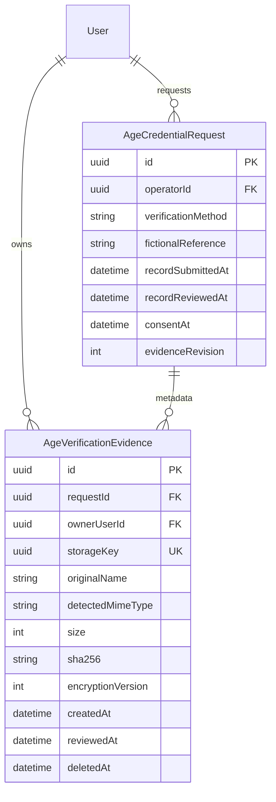

# AGE evidence — pilot nội bộ, 07/10/2026

Chỉ dùng hồ sơ hoàn toàn hư cấu. Không tích hợp KYC/VNeID, OCR, nhận diện khuôn mặt hoặc dịch vụ quét bên ngoài. Không dùng hệ thống với giấy tờ thật.

## Ranh giới và dữ liệu

Website 5173 tạo request và nhận trạng thái tối thiểu cùng boolean `recordSubmitted`; không nhận/proxy file, credential hoặc claim token. Issuer Portal 5175 gửi evidence trực tiếp tới dịch vụ Issuer hiện hữu 3002. Tái sử dụng phiên cookie, ADMIN operator, exact-origin allowlist và CSRF; CUSTOMER không được mở file operator. Không thêm worker/service/frontend mới.

PostgreSQL chỉ lưu metadata. `AgeCredentialRequest.operatorId` hiện hữu biểu diễn `recordReviewedBy`; `recordReviewedAt` và `AgeVerificationEvidence.reviewedAt` ghi cùng transaction APPROVE. Không backfill hồ sơ giả cho request cũ. Một evidence active/request được bảo vệ bằng partial unique index. Revision và row lock chống submit/review cạnh tranh. Phiên bản này không cho thay thế/xóa hồ sơ đã nộp qua UI.



```mermaid
sequenceDiagram
  participant W as Website 5173
  participant P as Issuer Portal 5175
  participant I as Issuer API 3002
  participant D as PostgreSQL + private ciphertext directory
  participant O as Operator
  participant C as Issuer CLI
  W->>P: /submit-age/requestId (không có secret)
  P->>I: Cookie + exact Origin + CSRF + consent + fictional file/method
  I->>D: Lock request, ownership/PENDING/revision checks
  I->>D: AES-256-GCM ciphertext + metadata + audit identifier
  P->>W: Fixed /account/age-verification/requestId
  O->>P: Xem hồ sơ và hoàn tất checklist
  P->>I: ADMIN authenticated file review (no-store)
  Note over I,D: Giải mã trong bộ nhớ tối đa 5 MB, response stream; không ghi plaintext
  P->>W: Shared operator API APPROVE + recordChecked + revision
  W->>D: Lock + submission/consent/active evidence + review timestamps
  C->>D: Chỉ claim APPROVED đã submitted/reviewed/operator
  Note over C: DOB hư cấu nhập thủ công; canonical signing không đổi
  Note over P,W: ISSUED tiếp tục Delivery hiện hữu; Website không nhận token
```

## API và kiểm soát

Issuer 3002: `GET/POST /issuer/age/requests/:id/submission` chỉ CUSTOMER sở hữu; người khác nhận 404. Upload `application/octet-stream`, tên URL-encoded qua `x-evidence-name`, consent/revision headers; max 5 MB trong parser và route. Phương thức không file dùng JSON strict `method`, `consent:true`, `revision`; EXTERNAL thêm mã `FICTIONAL-...` tối đa 100 ký tự, không gọi bên ngoài.

`GET /issuer/age/operator/requests/:id/evidence` trả metadata tối thiểu cho ADMIN. `POST /issuer/age/operator/requests/:id/file` yêu cầu ADMIN/Origin/CSRF, `no-store`, tên disposition cố định. Không trả storageKey/path/key/sha256 trong response JSON. File dùng UUID vật lý, AES-256-GCM IV ngẫu nhiên 12 byte, tag 16 byte, AAD storage UUID, envelope `AGEE1`; key base64 đúng 32 byte riêng biệt với Delivery, ngoài Git. PNG/JPEG preview bằng image; PDF trong iframe sandbox không script. Blob URL được revoke khi đóng/unmount.

Magic bytes + extension/name normalization chặn SVG/HTML/EXE/ZIP và extension kép; không giải nén hoặc thực thi. Giới hạn upload 10/phút/IP. Đây không phải antivirus hoặc kiểm định PDF/image toàn diện. Pilot dùng chung auth/DB và operator tin cậy; cần isolation/AV/CDR và quy trình thuộc tính xác minh thực tế trước khi mở phạm vi.

## Retention và phục hồi

Mặc định 24 giờ sau trạng thái terminal ISSUED/REJECTED/REVOKED (theo request.updatedAt); cấu hình `AGE_EVIDENCE_RETENTION_HOURS` 1–168. Owner cần chạy cleanup định kỳ; chưa cài scheduler. Giữ phương thức, request/operator/timestamps, SHA-256 và deletedAt; tên file được đổi thành `deleted`. Không giữ plaintext.

Dry-run: từ `apps`, chạy `npx tsx issuer/cleanup-age-evidence-cli.ts`. Chỉ sau owner duyệt kết quả mới thêm `--apply --owner-approved`; không chạy apply trên public trong lượt này. Unlink rồi ghi deletedAt idempotent, ENOENT cho phép phục hồi nếu crash giữa unlink/commit. Crash giữa ghi ciphertext/upload và commit có thể để lại orphan ciphertext: không tự xóa hàng loạt; owner đối chiếu metadata trước khi xử lý. Không tự xóa backup.

Tạo khóa local bằng CSPRNG 32 byte ở kênh riêng; lưu trực tiếp vào cấu hình private, không paste vào chat/log. Sao lưu khóa và ciphertext có kiểm soát; mất khóa không phục hồi được file. CLI chỉ ký sau review và không đọc evidence file. DOB nhập lại thủ công là giới hạn của đồ án, không phải quy trình cấp credential thực tế.

## Migration và kiểm chứng

Migration cộng dồn `202610070001_age_verification_evidence`, SHA-256 `7ECABADFC92E2AE3384CB94FAEE0EE907501C5E80D65D2225B8DE55F4F0A6D76`. Không sửa migration đã áp dụng, không reset/xóa dữ liệu. Preflight lifecycle/delivery/evidence trước và sau public đều 0 violation. Public 8 → 9 migration, tất cả finished, không rolled back; drift sạch. Backup full `.work/backups/banviviet-owner-full-before-age-evidence-20261007.dump`: 1,179,775 byte, `pg_restore -l` PASS (439 dòng catalog), không đọc nội dung dữ liệu.

Row count public trước/sau không đổi: Address1, AgeChallenge4, AgeCredentialClaim0, AgeCredentialDelivery0, AgeCredentialRequest1, AgeVerification2, AuditLog4, Cart2, CartItem0, Category3, InventoryMovement4, Lot3, LotCredential1, LotProof1, Order4, OrderHistory6, OrderItem4, Product8, Session5, User2. Bảng evidence mới0. Dữ liệu Browser E2E chỉ ở `g2_test_20261005`, không ở public.

Storage local ngoài repo/web root; ACL chỉ SYSTEM và owner FullControl, không broad principal. Kiểm tra cấu hình chỉ presence/path/length/separate-key. Sự cố diagnostic trước migration: exception parse URL đã lộ mật khẩu DB local trong tool output. Không lặp giá trị; owner cần xoay mật khẩu đó. Evidence/Delivery/private key không được in hoặc đọc từ file secret.

Browser thực tế: `http://127.0.0.1:5173/tai-khoan` → `http://127.0.0.1:5175/submit-age/483cda5f-eed1-4b94-a7fb-e78f7c139523` → Website `/account/age-verification/483cda5f-eed1-4b94-a7fb-e78f7c139523` → Portal `/operator/483cda5f-eed1-4b94-a7fb-e78f7c139523`. Fixture PNG có nhãn fictional, không giấy tờ/định danh thật. Checklist chưa đủ thì nút disabled, sau xác nhận APPROVED. Ảnh giải mã hiển thị natural size900×520. Desktop/mobile390×844 không tràn ngang; console warn/error rỗng tại lần kiểm tra cuối.

Ciphertext file thực tế trong thư mục owner: envelope PASS, không header PNG, kích thước plaintext+33, GCM authenticated decrypt + SHA-256 khớp; chỉ in boolean. API kiểm thử không trả path/storageKey/key hoặc plaintext JSON. File fictional E2E đang APPROVED được giữ mã hóa để owner tiếp tục CLI; không chạy CLI/private key/credential owner. Cleanup dry-run/apply chỉ kiểm thử trong thư mục và schema test cô lập.

Hồi quy dùng `TEST_DATABASE_URL` trỏ `g2_test_20261005`, không đổi apps/.env. Cảnh báo: chạy mặc định lần cuối đã trỏ schema cũ `g2_test`, migration LOT003 thất bại vì legacy issuer key (23514). Không rollback/resolve/sửa dữ liệu hoặc lịch sử của schema đó. Owner phải xử lý riêng trước khi dùng lại cấu hình test mặc định. Public và schema E2E không có failed migration.

G1 static45/45 và witness evidence71/71 được bảo toàn; không chạy lại harness witness owner. Circuit, public signals, trusted setup, credential schema và Delivery token protocol không đổi. Đây là pilot nội bộ, không production-ready.

Kết quả hồi quy cuối: 96/96 test PASS trên g2_test_20261005; build Website/Wallet/Issuer Portal và TypeScript tsc --noEmit PASS. Vite cảnh báo chunk lớn ở Website/Wallet, không phải lỗi build. Kiểm tra public cuối: migrate status up-to-date, drift no difference, cả ba preflight lifecycle/delivery/evidence đều 0. Stack E2E đã dừng và khởi động lại bằng cấu hình public owner.

File triển khai: prisma/schema.prisma + migration mới; apps/api/src/app.ts; apps/issuer/evidence-storage.ts, evidence-service.ts, delivery-service.ts, delivery-server.ts, issue-age.ts, cleanup-age-evidence.ts, cleanup-age-evidence-cli.ts; apps/issuer-portal/src/App.tsx và evidence.tsx; apps/web/src/App.tsx, api.ts. Test/fixture: apps/issuer/evidence-service.test.ts, evidence-browser-fixture.ts, evidence-browser-check.ts, create-fictional-evidence.py; apps/api/tests/run.ts và checkout.test.ts. Tài liệu: README, decisions, api-erd, security-assessment, guide-customer, guide-issuer-operator, preflight evidence và báo cáo này. Không chỉnh circuit/G1/credential/Delivery protocol.

## Checklist owner

1. Đăng nhập khách Website, tạo hoặc tiếp tục request chưa có hồ sơ.
2. Tại Issuer chọn phương thức; với upload chỉ chọn fixture hư cấu, consent rồi gửi.
3. Website chỉ hiện trạng thái đã gửi, không file; user khác không xem request.
4. Operator đăng nhập Portal /login, mở file qua endpoint bảo vệ, hoàn tất checklist rồi APPROVE.
5. Chạy CLI riêng với dữ liệu hư cấu sau review; ISSUED nhận qua Portal/Wallet theo protocol cũ.
6. Sau retention chạy cleanup dry-run, owner duyệt mới apply; không dùng giấy tờ thật.
