# API, Ví ZKP và mô hình dữ liệu G5

## Bổ sung pilot SME (04/10/2026)

- `GET/POST /api/me/age-credential-requests`: khách xem/gửi yêu cầu; không nhận DOB/private input.
- `GET /api/admin/age-credential-requests`: operator xem hàng đợi.
- `PATCH /api/admin/age-credential-requests/:id`: ADMIN duyệt/từ chối/thu hồi và ghi audit.
- `POST /api/admin/lots/:id/revoke`: bắt buộc lý do và cập nhật trạng thái theo transaction.

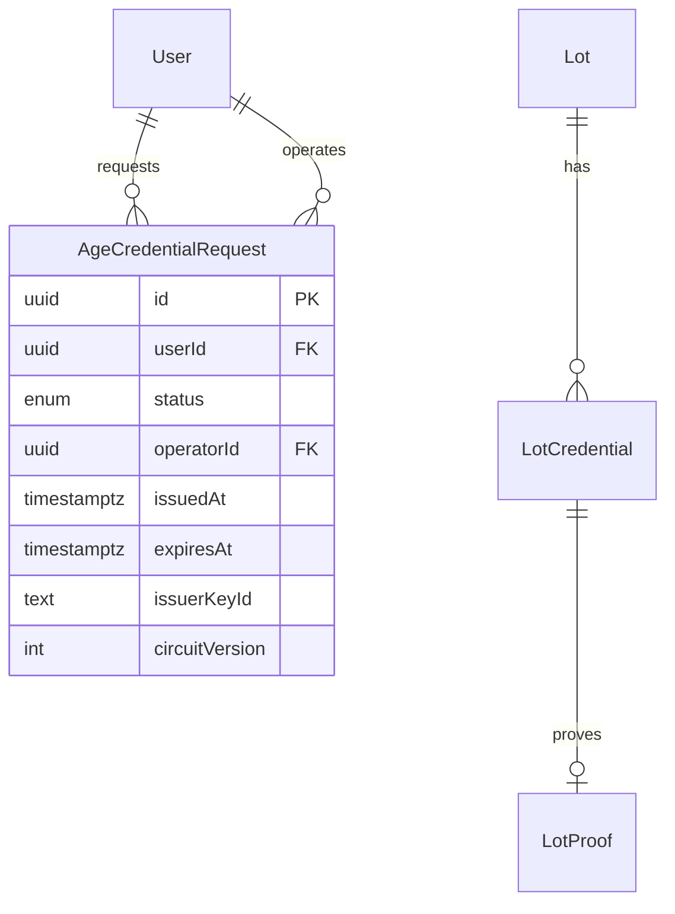

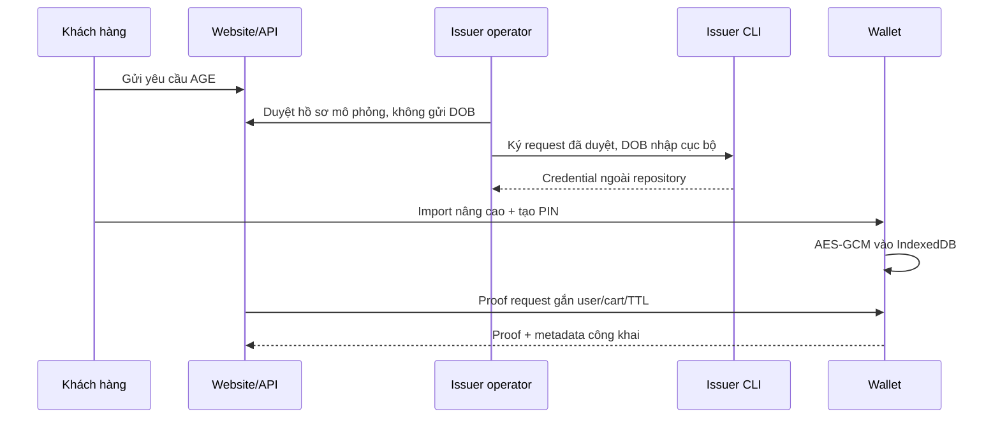

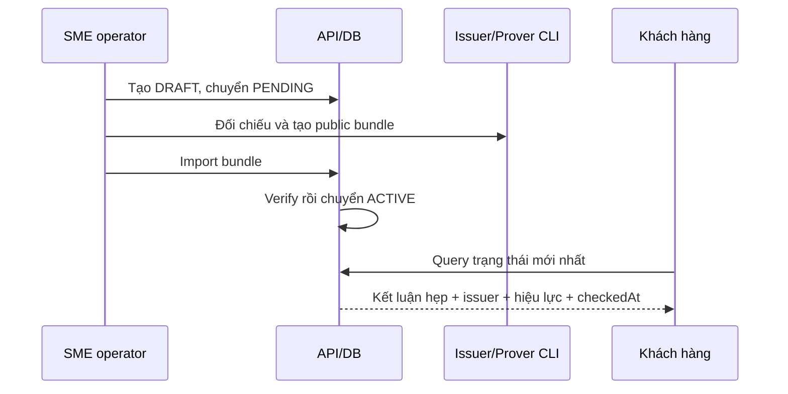

API public không trả DOB, salt, holderSecret, supplierIdHash, privateLotCodeHash, private credential hoặc delivery secret.

Ngày chốt G4: 28/09/2026. Cập nhật Ví AGE tách origin: 29/09/2026. Đối chiếu G5: 30/09/2026. Circuit, public signals, khóa và mô hình dữ liệu G1–G4 giữ nguyên; G5 không tạo migration hoặc đổi schema.

## Kiến trúc chạy demo

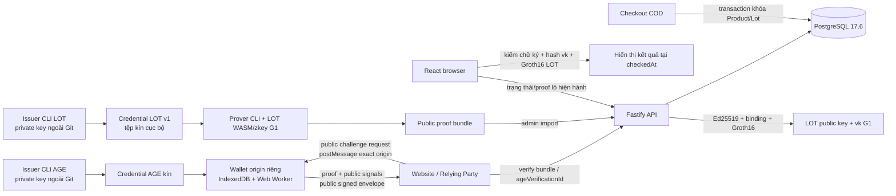

Issuer và Wallet là vai trò mô phỏng. AGE credential kín chỉ nằm trong tệp nhập và IndexedDB của Wallet origin; website/API không nhận DOB, `dobDay`, salt, holderSecret, witness hoặc toàn bộ credential. LOT credential kín chứa `supplierIdHash`, salt và dữ liệu witness chỉ tồn tại trong tệp cục bộ/prover. API/DB chỉ nhận phần công khai cần xác minh/audit.

## ERD

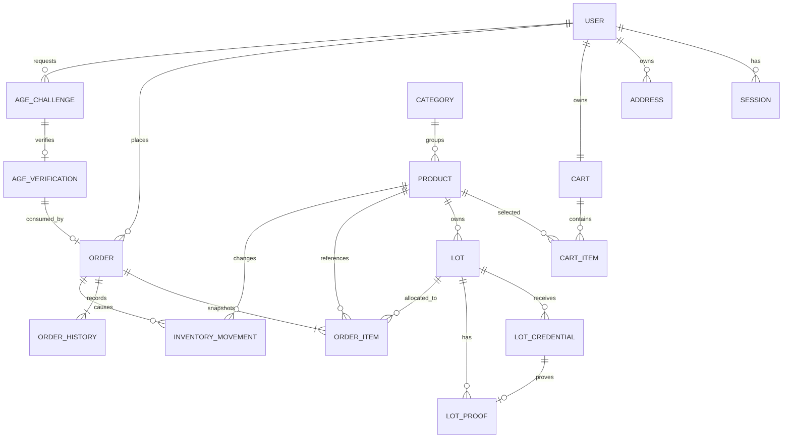

### Các trường G4

| Bảng            | Trường/ràng buộc chính                                                                                                                                               |
| --------------- | -------------------------------------------------------------------------------------------------------------------------------------------------------------------- |
| `Lot`           | `productId`, unique `(productId,lotCode)`, `status`, `stock >= 0`. `certificateStatus/expiresAt` cũ được giữ để migration tương thích nhưng không quyết định nhãn G4 |
| `LotCredential` | UUID credential, `lotId`, commitment, product/lot hash, policy/code, issuer/version/fingerprint, chữ ký, issued/expires, `ACTIVE/REVOKED/SUPERSEDED`, `revokedAt`    |
| `LotProof`      | unique `credentialId`, `lotId`, proof JSON công khai, đúng ba signals, proof hash, manifest/schema hash, generated/verified time, `ACTIVE/STALE`                     |
| `OrderItem`     | snapshot `lotId` nullable và `lotCode` nullable bên cạnh product/name/quantity/unitPrice                                                                             |

Migration `202609280004_g4_lot` cộng cột/bảng và backfill tồn hiện có: với mỗi sản phẩm đã có lô, lô đầu theo `lotCode` nhận tồn tổng hiện tại, các lô còn lại nhận 0. Migration không xóa order, cart hoặc volume.

## Endpoint và luồng AGE Wallet Protocol v1

| Method và path                  | Quyền           | Hành vi chính                                                                                                                                |
| ------------------------------- | --------------- | -------------------------------------------------------------------------------------------------------------------------------------------- |
| `POST /api/age/challenges`      | Customer + CSRF | Tạo challenge 300 giây từ account/cart/cutoff server; trả requestHash, subjectHash, artifact URL/hash và đúng thứ tự signals G1              |
| `GET /api/zkp/age/wasm`         | Công khai       | Trả WASM AGE G1; CORS chỉ phản hồi cho Wallet origin cấu hình; cache immutable                                                               |
| `GET /api/zkp/age/zkey`         | Công khai       | Trả owner zkey AGE G1; CORS chỉ phản hồi cho Wallet origin cấu hình; cache immutable                                                         |
| `POST /api/age/verifications`   | Customer + CSRF | Parse public bundle nghiêm; kiểm challenge/cart/cutoff/requestHash, Issuer/signature/hạn, signals, Groth16/nullifier; tạo `VERIFIED`          |
| `POST /api/orders`              | Customer + CSRF | Nhận `ageVerificationId` thay vì proof. Trong transaction kiểm lại binding/hạn/Issuer/giá/tồn/lô, tạo đơn rồi chuyển challenge thành CONSUMED |

```mermaid
sequenceDiagram
  participant R as Website RP
  participant W as Wallet origin
  participant A as API
  participant D as PostgreSQL
  R->>A: POST age/challenges (cart hiện tại)
  A->>D: lưu ISSUED + nonce/cartHash/requestHash/TTL
  A-->>R: public challenge + subjectHash + artifact metadata
  R->>W: popup postMessage(requestId, challenge public), exact targetOrigin
  W->>W: kiểm origin/source/schema/TTL/replay; chờ consent
  W->>W: đọc IndexedDB, Web Worker witness + Groth16 proof
  W-->>R: public proof response, exact returnOrigin
  R->>A: POST age/verifications
  A->>D: lưu public audit + proofHash + nullifier, status VERIFIED
  A-->>R: ageVerificationId
  R->>A: POST orders(ageVerificationId)
  A->>D: transaction kiểm lại, trừ tồn/gán lô/tạo đơn/CONSUMED
```

Wallet và website đều kiểm exact origin, `event.source`, UUID request/challenge và expiry; request ID chỉ được Wallet xử lý một lần trong phiên. Website chỉ hiện “Đã xác minh” sau phản hồi thành công của API. Checkout thất bại trước commit không tiêu thụ verification nên có thể retry; checkout thành công tiêu thụ challenge/nullifier đúng một lần. Một snapshot giỏ có bao nhiêu sản phẩm 18+ cũng chỉ tạo một proof. Địa chỉ không thuộc requestHash AGE v1, nhưng website chủ động xóa trạng thái xác minh khi người dùng đổi địa chỉ.

## Endpoint G4

| Method và path                          | Quyền                     | Hành vi chính                                                                                                            |
| --------------------------------------- | ------------------------- | ------------------------------------------------------------------------------------------------------------------------ |
| `GET /api/zkp/lot/verification-key`     | Công khai                 | Trả đúng bytes JSON vk LOT G1 sau khi server đã kiểm SHA-256                                                             |
| `GET /api/lots/:id/proof-bundle`        | Công khai                 | Tính trạng thái hiện tại; `Cache-Control: no-store`; chỉ `ACTIVE` mới kèm bundle/key/fingerprint                         |
| `POST /api/admin/lots/:id/proof-bundle` | Admin + CSRF              | Parse nghiêm; kiểm artifact, chữ ký, product/lô, policy, hạn, signals và Groth16; supersede proof cũ rồi lưu public data |
| `POST /api/admin/lots/:id/revoke`       | Admin + CSRF              | Trong một transaction đổi credential `REVOKED`, proof `STALE` và ghi audit                                               |
| `GET/POST/PATCH/DELETE /api/admin/lots` | Admin + CSRF cho mutation | Quản lý mã, trạng thái và tồn lô; không có cờ verified thủ công                                                          |
| `POST /api/orders`                      | Customer + CSRF           | Giữ G2/G3 và thêm chọn/trừ/snapshot lô atomically                                                                        |
| `POST /api/me/orders/:id/cancel`        | Customer + CSRF           | Hoàn tồn Product và Lot đúng một lần khi hủy `PENDING`                                                                   |

Các endpoint tài khoản, catalog, cart, địa chỉ, order, AGE challenge/artifact và quản trị khác giữ hành vi G3 đã ghi trong lịch sử tài liệu.

## Kiểm proof và trạng thái lô

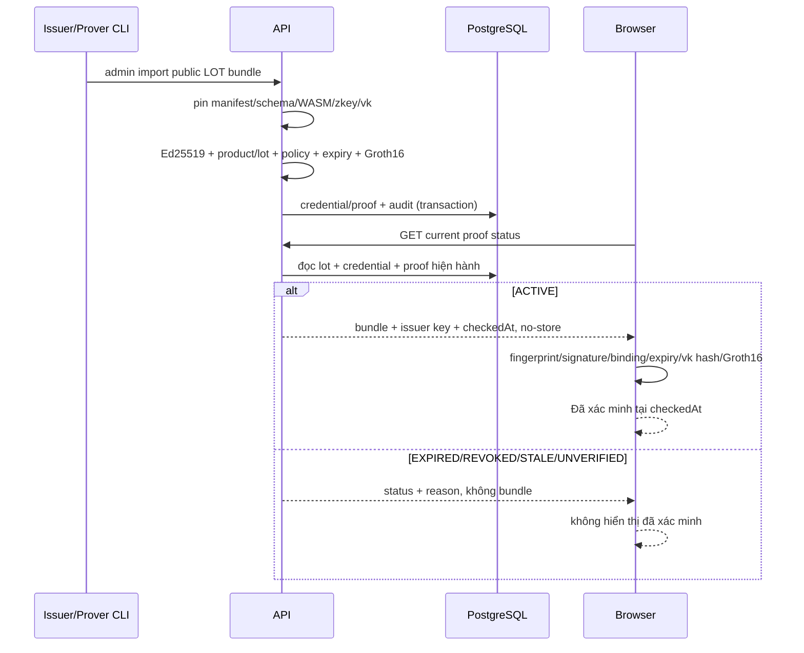

Proof Groth16 cũ có thể vẫn đúng về mật mã sau khi credential hết hạn hoặc bị thu hồi. Nhãn website phụ thuộc trạng thái API tại `checkedAt`, vì vậy API không trả bundle cho mọi trạng thái khác `ACTIVE`. Verifier CLI offline chỉ kiểm artifact/chữ ký/binding/hạn/proof và luôn in `REVOCATION NOT CHECKED`.

## Phân bổ lô trong checkout

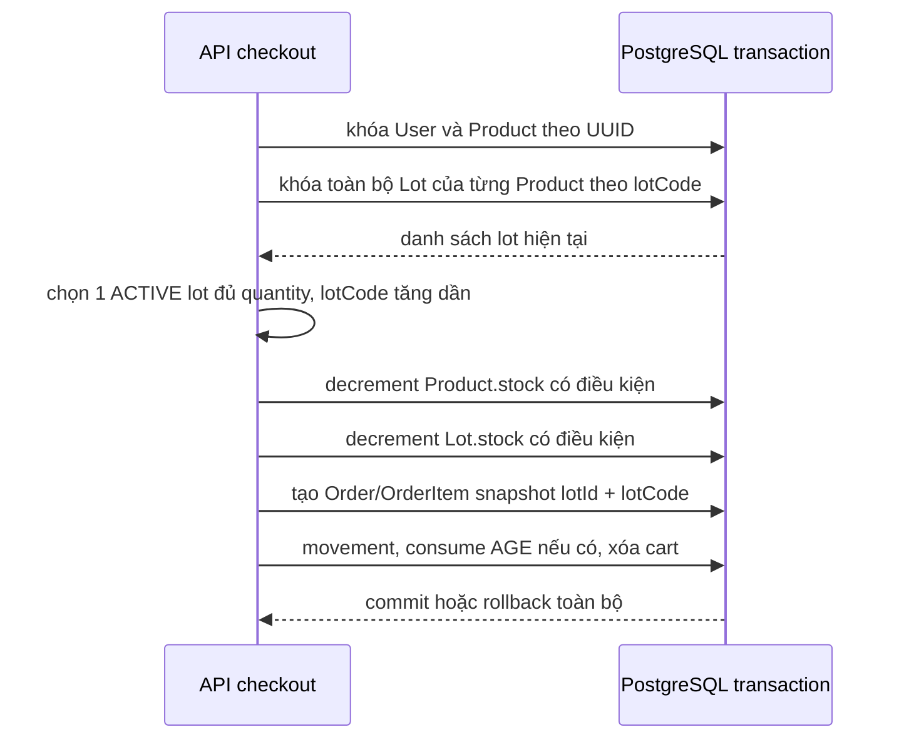

Sản phẩm có ít nhất một `Lot` bắt buộc được phân bổ đúng một lô; v1 không split một order item. Không có lô `ACTIVE` riêng lẻ đủ quantity trả `LOT_OUT_OF_STOCK`. Sản phẩm không có lô để `lotId/lotCode` trống. Trạng thái proof lô không quyết định bán được hay không; nó chỉ quyết định nhãn xác minh. Client không gửi lựa chọn lô.

## Đối chiếu vận hành G5

- `GET /api/health` trả `status=ok`, `gate=G5`, `ageZkp=integrated`, `lotZkp=integrated`. Bốn migration hiện có đã được áp dụng; `prisma migrate deploy` báo không có migration chờ trên schema public. G5 không thêm migration.
- Test schema `g2_test` đạt 58/58. Các invariant thêm ở G5 xác nhận giỏ thường không tạo `AgeChallenge`, một giỏ có nhiều mặt hàng 18+ dùng đúng một challenge/verification, nullifier có unique constraint tại DB, retry sau lỗi trước commit vẫn dùng được verification, và tranh tồn không bán âm.
- API artifact AGE chỉ trả CORS cho Wallet origin. Hash WASM/zkey được Wallet kiểm trước khi dùng từ network hoặc Cache Storage; cache sai hash bị xóa và fail closed. Website chỉ gửi `ageVerificationId` khi checkout.
- Audit tên cột trên schema public không tìm thấy `dob`, `dobDay`, `salt`, `holderSecret`, `witness`, `supplierIdHash`, `privateLotCodeHash`, private key hoặc credential kín. Tại mốc kiểm tra có 0 `AgeChallenge`, 0 `AgeVerification`, 1 `LotCredential` và 1 `LotProof`; LOT bundle active không chứa tên hay giá trị `supplierIdHash`, salt hoặc `privateLotCodeHash`.
- Trạng thái LOT thực tế: lô `BP-2026-03` của `hat-dieu-binh-phuoc` trả `ACTIVE` cùng `checkedAt` và hạn credential, còn lô `DL-2026-01` không có proof hiển thị `UNVERIFIED`. Các ca hết hạn, revoke sau khi tạo proof và stale được test tự động; API không trả bundle ở các trạng thái đó.

Các số đếm là ảnh chụp trạng thái DB demo tại thời điểm kiểm tra, không phải ràng buộc seed. Hồ sơ chi tiết nằm ở `docs/evidence/g5/test-results.json`; owner E2E AGE không thay đổi ERD và đang `PENDING OWNER MANUAL TEST`.

## AGE credential delivery (pilot nội bộ)

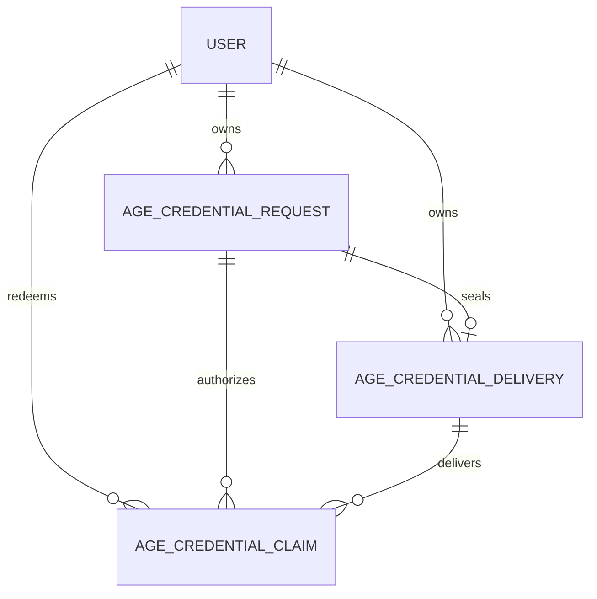

`AgeCredentialDelivery` giữ envelope AES-256-GCM phía Issuer, không phải bản rõ. `AgeCredentialClaim.tokenHash` là SHA-256 của token 256 bit; token thô chỉ xuất hiện trong claim URL và request body Wallet–Issuer. TTL được ràng buộc đúng 5 phút. Trạng thái chỉ chuyển `ACTIVE → CLAIMED` sau ACK của Wallet.

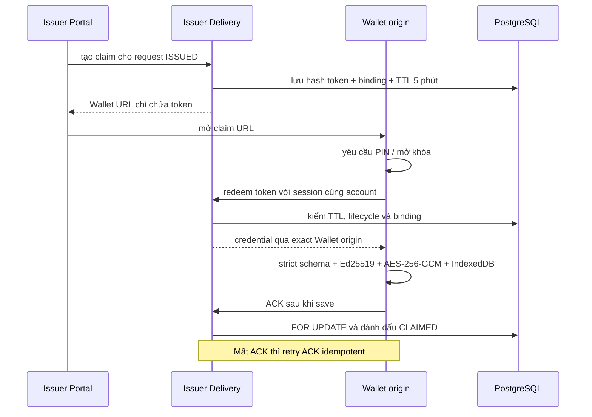

Delivery không đi qua website payload hoặc API thương mại. Log/audit không chứa token, credential, PIN hay private inputs.

## Tách origin Issuer Portal (06/10/2026)

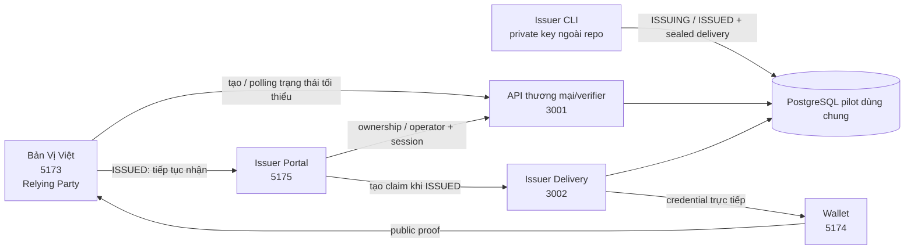

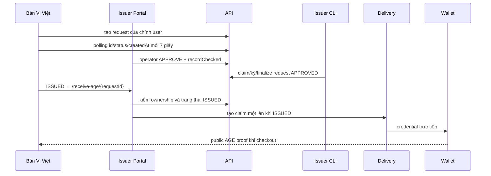

Issuer Portal được tách origin để mô phỏng ranh giới tin cậy. Pilot vẫn dùng chung API xác thực và PostgreSQL nhằm giới hạn phạm vi. Khi triển khai thực tế, Issuer cần tổ chức, tài khoản, API, cơ sở dữ liệu và hạ tầng quản lý khóa độc lập.
# AGE evidence bổ sung 07/10/2026

Xem [endpoint, ERD và sequence mới](age-evidence-2026-10-07.md). Website chỉ nhận recordSubmitted boolean; Issuer giữ metadata/file. APPROVE yêu cầu recordChecked và evidenceRevision hiện tại, submission/consent và active evidence đúng ownership; review/operator ghi nguyên tử. Sơ đồ AGE trước đây được bổ sung bước nộp/review trước APPROVED.

