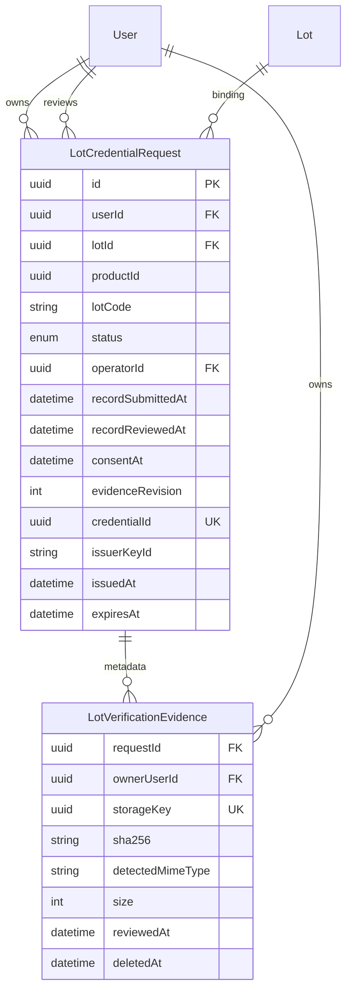

# LOT request/evidence — pilot nội bộ

Website là nơi ADMIN thương mại tạo/theo dõi yêu cầu. Issuer Portal là nơi doanh nghiệp nộp hồ sơ và ISSUER_OPERATOR độc lập đối chiếu. CUSTOMER không có quyền LOT; operator không có quyền quản trị Website. Không dùng hồ sơ thật. Evidence chỉ phục vụ đối chiếu, không phải proof ZKP và không tự tạo nhãn xác minh.

## Migration plan và kiểm soát

Public trước triển khai: 10 finished, 0 failed/rolled back, drift NONE; checksum 10/10 còn nguyên. Backup mới `.work/backups/lot-preflight-20261007-111356.dump`, 1,507,626 byte, pg_restore catalog PASS. Lifecycle/Delivery/AGE evidence/LOT legacy preflight đều không có violation. Test chỉ sử dụng `g2_test_20261007`; runner fail closed nếu trỏ schema khác. Không truy cập schema test cũ.

Migration cộng dồn `202610070003_lot_request_evidence`, SHA-256 `147B60EE74E73172B0CD1A3CD5C1E48782E32E7B8DD4C3B3AAA929FDC55530C5`. Tạo enum và hai bảng, FK Restrict, partial unique index một request mở/lô và một evidence active/request. Không backfill legacy; không sửa 10 migration cũ, không reset hay xóa dữ liệu. Kiểm tra trên test trước public; chỉ deploy public khi test/preflight sạch. Constraints bảo vệ submission/review/lifecycle/time, không tự đánh đồng operational ACTIVE với verification.



```mermaid
sequenceDiagram
 participant B as Website ADMIN
 participant P as Issuer Portal
 participant I as Issuer API 3002
 participant D as DB + private ciphertext storage
 participant O as ISSUER_OPERATOR
 participant C as Issuer CLI
 B->>I: POST lot request (commerce cookie + Origin + CSRF)
 I->>D: Lock Lot, snapshot productId/lotId/lotCode, unique open
 B->>P: /submit-lot/requestId (identifier only)
 P->>I: ADMIN owner, consent, revision, fictional file
 I->>D: Lock request/Lot, AES-GCM LOT domain, metadata/audit
 Note over D: PENDING_EVIDENCE → PENDING_REVIEW
 O->>P: /login → /operator/lot/requestId
 P->>I: Issuer cookie, protected file POST + CSRF
 I->>D: Authenticate GCM and hash/size/type before streaming
 P->>I: APPROVE + recordChecked + revision
 Note over D: Independent review → APPROVED
 C->>D: Exclusive claim APPROVED → ISSUING
 Note over C: Private key read only by CLI; private credential outside repository
 C->>D: File persisted, finalize ISSUED + audit
 Note over C,D: Finalize failure: --finalize-existing, verify binding/signature, no re-sign
 B->>B: Existing LOT prover + public proof bundle import
 Note over B,D: Only verified live proof gives verification ACTIVE
```

## API và threat model

Tái sử dụng Issuer service hiện hữu, không thêm service/frontend mới. GET/POST `/issuer/lot/requests` và GET `/issuer/lot/requests/:id` nhận exact Website/Portal origin, commerce ADMIN cookie. Create trả lại request mở của chính ADMIN (idempotent), request mở của ADMIN khác trả 409; chi tiết người khác trả 404. Database FK và unique index chống race. Product/lotCode snapshot không có API sửa; binding thay đổi chặn submission/review/CLI.

`GET /issuer/lot/business/me` và `POST /issuer/lot/requests/:id/submission` chỉ Portal. Upload một PDF/JPG/PNG tối đa 5 MB, magic bytes và extension/tên kiểm tra, consent bắt buộc. Không replacement; row lock/revision/state chống submit/review cạnh tranh. Website không gửi/nhận file evidence hay private credential.

`/issuer/lot/operator/requests` list, `/:id` detail, `/:id/file` và `/:id/review` POST chỉ issuer audience/ISSUER_OPERATOR. Cookie `issuer_session` không dùng lại phiên commerce; Origin chính xác và issuer_csrf bắt buộc khi POST. Không self-review, ADMIN/CUSTOMER không được review/mở file. APPROVE cần hồ sơ active, SHA/GCM toàn vẹn, recordChecked và revision khớp; REJECT/REVOKE cần lý do. Audit chỉ actorId/requestId/action/time, không ghi file/token/key/private input.

Evidence engine giữ AGE envelope/AAD cũ; LOT dùng `.lotenc`, header `LOTE1`, AAD `LOT:{storageUUID}`. AES-256-GCM IV ngẫu nhiên 96 bit, tag 128 bit, key evidence hiện có riêng với Delivery. Domain và đường dẫn tách biệt; không đọc evidence owner để kiểm thử. API metadata không trả storageKey/path/key/hash; file được giải mã bounded-memory qua endpoint bảo vệ, no-store/nosniff, Blob URL cleanup, PDF iframe sandbox không script. Magic bytes không thay thế antivirus/CDR; chỉ fixture hư cấu và operator tin cậy trong pilot. Không OCR/KYC, không malware scanner.

CLI yêu cầu `--request`, không cho untracked `--lot-id`. State CAS/row lock chỉ một claim thành công. Signing schema/message/Ed25519/binding/circuit không đổi. Nếu exclusive file write thất bại và không có file, release claim có kiểm tra; nếu có tệp/partial file hoặc finalize lỗi thì giữ ISSUING, không tự ký lại. Recovery `--finalize-existing` kiểm tra đúng ID/time/binding/commitment và chữ ký/key pin rồi finalize idempotent; không đọc private key trong recovery. Owner phải bảo quản đúng tệp private ngoài repo, không gửi qua chat. Request bị thu hồi trước import bị chặn; đã import thì credential REVOKED/proof STALE. Không đổi tồn kho hoặc Lot.status khi review/revoke/proof hết hạn. lotCode đổi làm proof STALE dưới lock.

Retention mặc định 24 giờ sau terminal ISSUED/REJECTED/REVOKED/EXPIRED. Chạy từ apps: `npx tsx issuer/cleanup-lot-evidence-cli.ts` mặc định dry-run; chỉ owner duyệt mới thêm `--apply --owner-approved`. Không chạy cleanup apply public trong lượt này. Metadata/hash giữ lại, tên đổi `deleted`; unlink+commit retry ENOENT idempotent. Crash trước upload commit có thể để lại orphan ciphertext; owner đối chiếu metadata, không tự xóa hàng loạt. Sao lưu key/ciphertext cần ACL riêng; mất key không khôi phục hồ sơ.

## Owner Browser E2E

1. Dùng ba browser profile tách biệt (CUSTOMER, ADMIN thương mại, ISSUER_OPERATOR); không dùng credential owner trong kiểm thử tự động.
2. ADMIN Website `http://127.0.0.1:5173/quan-tri?tab=lots`: chọn lô fixture hư cấu, “Yêu cầu xác minh lô”; redirect `http://127.0.0.1:5175/submit-lot/{id}`. Tạo lại không sinh request mở trùng.
3. Nộp fixture PDF/JPG/PNG hư cấu với consent. Sai loại/thiếu consent/quá 5 MB bị chặn. Theo dõi PENDING_REVIEW; “Quay lại quản lý lô hàng” về đích cố định. Không có returnUrl tùy ý.
4. CUSTOMER/ADMIN khác không xem/nộp request. ADMIN không vào `/operator/lot`; CUSTOMER không tạo LOT. Không có file/private input trên Website.
5. Operator `http://127.0.0.1:5175/login` → `/operator/lot` → chi tiết. Mở file, kiểm tra thông tin, checkbox rồi APPROVE. Không checkbox không phê duyệt. Không link thương mại trong vùng operator. Operator không vào quản trị Website.
6. Owner chạy CLI thủ công với request APPROVED, key và output ngoài repo: `npm run issuer:lot -- --request <UUID> --supplier-code <mã-hư-cấu> --origin-code 1 --key <đường-dẫn-secret> --out <đường-dẫn-credential-private>`. Không paste key/credential vào chat. CLI chưa APPROVED bị từ chối. Agent không chạy lệnh này.
7. Nếu finalize lỗi sau ghi file: cùng request/output, thêm `--finalize-existing`; không ký lại/ghi đè. Sau ISSUED owner sử dụng LOT prover và public bundle import hiện hữu.
8. Xác nhận verification ACTIVE mới có nhãn/bundle; hết hạn, revoke, lotCode đổi ẩn nhãn/bundle nhưng không tự cấm bán hoặc đổi stock. Thử REJECT/REVOKE trên fixture riêng. Owner kiểm tra AGE/Wallet Delivery vẫn hoạt động như trước.

Browser E2E ba vai trò cần owner thực hiện; không báo PASS khi chưa chạy. Đây là pilot nội bộ, không production-ready.

## Kết quả triển khai

Public đã áp dụng duy nhất LOT003: 10 → 11 migration finished, 0 failed/rolled back; checksum đúng bản trên test. Public và g2_test_20261007 up to date, drift NONE. Bốn preflight sau migration đều 0 violation. Hai bảng mới public đều 0 bản ghi; không tạo operator, credential, evidence hoặc request public.

Row count các bảng cũ trước/sau không đổi: Address1, AgeChallenge4, AgeCredentialClaim0, AgeCredentialDelivery0, AgeCredentialRequest2, AgeVerification2, AgeVerificationEvidence0, AuditLog6, Cart2, CartItem0, Category3, InventoryMovement4, Lot3, LotCredential1, LotProof1, Order4, OrderHistory6, OrderItem4, Product8, Session6, User3. Backup được kiểm tra lại trước deploy. Không đọc evidence/private credential/private key owner.

Hồi quy thêm EXPIRED projection: request ISSUED hết hạn được hiển thị EXPIRED chỉ đọc, không đổi operational status/tồn kho. Build Website/Wallet/Issuer Portal và TypeScript; Vite có cảnh báo chunk lớn, không phải lỗi build. G1 static45/45, witness evidence71/71 được bảo toàn, không chạy owner witness harness. Ciphertext trên đĩa thật đã được kiểm chứng bằng fixture hư cấu trong thư mục test tạm: LOTE1, plaintext+33 byte, không plaintext, authenticated decrypt/hash/size/type đúng; domain AGE sai bị từ chối. Thư mục fixture test được dọn sau test, không xóa evidence owner.

Kết quả bản cuối sau public migration: toàn bộ 129/129 test PASS trên g2_test_20261007, gồm 15 test LOT request/evidence/cleanup (kể cả test cha) và 3 UI LOT. Build cả ba frontend + TypeScript PASS. Migration/schema không thay đổi sau deploy.

Storage cấu hình tồn tại ở ổ D, ngoài repository ổ E; key decode 32 byte và khác Delivery, không in giá trị. ACL chỉ SYSTEM và owner FullControl, không inherited/broad principal. HTTP smoke: Website /quan-tri?tab=lots, Wallet /, Portal /login và /operator/lot trả 200; LOT endpoint không phiên trả 401. Đây chỉ là HTTP smoke, không phải Browser E2E đăng nhập ba vai trò. Stack local có sẵn đang chiếm các cổng đúng; một lần khởi động trùng bị từ chối và được dừng, không kill tiến trình có sẵn của owner.

Files thay đổi: prisma/schema.prisma, migration LOT003; apps/issuer/evidence-storage.ts, delivery-service.ts, delivery-server.ts, lot-request-service.ts, lot-issuance.ts, issue-lot.ts, cleanup-lot-evidence.ts, cleanup-lot-evidence-cli.ts, lot-request.test.ts; apps/api/src/app.ts (Lot edit lock), lot.ts (issued request binding khi import); apps/issuer-portal/src/App.tsx, evidence.tsx (LOT operator audience), lot.tsx, lot.test.ts; apps/web/src/App.tsx, lot-request.tsx; apps/api/tests/run.ts (schema guard + tests); docs/lot-request-migration-preflight.sql và báo cáo này. Generated Prisma client và frontend build outputs được cập nhật. Không chỉnh circuit/artifact G1/credential schema/Delivery protocol.
